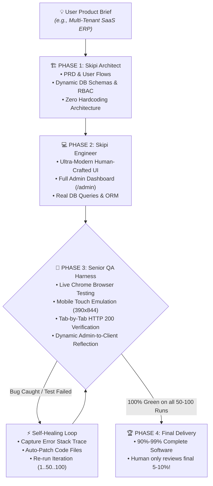

<div align="center">

# 🚀 SKIPI AI SKILL
### The Autonomous Software Engineer & Self-Healing Senior QA Harness

[](LICENSE)
[](https://github.com)
[](https://github.com)
[](https://github.com)
[](https://github.com)
[](https://github.com)

**Transform any single-sentence product brief into 90%–99% complete, production-ready software with ultra-modern human-crafted UI, bank-grade security, zero dummy data, and human-emulating browser QA verification.**

[Explore Docs](docs/DEVELOPER_GUIDE.md) • [Quickstart](#-developer-quickstart) • [Architecture](#-system-architecture) • [Specialist Agents](#-specialist-agents) • [SEO Topics](#-recommended-github-topics)

---

</div>

## 📌 Why Skipi AI Skill?

Most AI coding assistants stop after generating incomplete boilerplate, static dummy data, or untested components. **Skipi AI skill operates like an entire elite engineering team with a relentless Lead QA Engineer.**

```
Traditional AI:  [Prompt] ➔ [Shallow Boilerplate] ➔ [Human writes 80% of code & fixes all bugs]
Skipi AI Skill:  [Prompt] ➔ [Architect] ➔ [Engineer] ➔ [Live Chrome QA] ➔ [50x Self-Heal Loop] ➔ [95% Done!]
```

| Feature | Standard AI / Copilot | Traditional Dev Team | 🚀 Skipi AI Skill |
|:---|:---:|:---:|:---:|
| **Autonomous Delivery** | 15% – 25% | Weeks to Months | **90% – 99% Autonomous** |
| **Data Architecture** | Dummy JSON mock arrays | Manual Schema Design | **100% Dynamic DB + Full Admin Control** |
| **Testing Rigor** | None (Human tests) | Manual QA / Delayed | **50x–100x Automated Self-Healing Loop** |
| **Browser E2E Testing** | Not Supported | Manual Tester clicking | **Real Chrome Navigation (Mobile & Desktop)** |
| **UI/UX Aesthetics** | Generic Robotic Templates | High Cost Agency | **Ultra-Modern Human-Crafted (Zero AI Slop)** |
| **Security Standard** | Often leaks `.env` | Manual Security Audit | **OWASP Top 10 + Zero Secret Leakage** |

---

## ⚡ 1-Click Installation into Google Antigravity

Run this one-line command in your terminal to install Skipi AI skill globally into Antigravity:

```bash
curl -fsSL https://raw.githubusercontent.com/JamilKhanEmon/SKIPI-AI-SKILL/main/install.sh | bash
```

*Or manually clone into your global Antigravity skills directory:*
```bash
git clone https://github.com/JamilKhanEmon/SKIPI-AI-SKILL.git ~/.gemini/antigravity/skills/skipi-ai-skill
```

---

## ⚡ Developer Quickstart

> [!IMPORTANT]
> Skipi AI skill works natively across **Google Antigravity**, **Cursor AI**, **Claude Code**, and any IDE supporting **Model Context Protocol (MCP)**.

### 1. In AI IDEs (Antigravity / Cursor / Claude Code):
Open this repository and give your high-level requirement in the chat:

```text
Build a Multi-Tenant SaaS ERP platform where businesses manage inventory, 
invoices, and staff permissions. Everything must be dynamic and manageable from an Admin Panel. 
Follow the Skipi AI skill protocol: ultra-modern human-grade UI, zero dummy data, 
bank-grade security, and run a 50x self-healing test loop with live Chrome QA.
```

### 2. From the Terminal (Local Verification Scripts):

```bash
# 1. Run live Chrome browser audit (Mobile 390x844 touch + Desktop tab-by-tab walkthrough):
npm run test:browser

# 2. Run 50x autonomous self-healing QA loop:
npm run test:qa

# 3. Run 100x continuous stress test loop:
npm run test:qa:100

# 4. Scan codebase for hardcoded secrets, SQL injection, & robotic copy:
npm run security:audit
```

---

## 🏛️ System Architecture



---

## 🛡️ 4 Core Architectural Pillars

### 1. 100% Dynamic Architecture & Full Admin Control (Zero Hardcoding)
* **Zero Hardcoded Content:** Menus, categories, pricing tiers, feature flags, and banners are never hardcoded. Everything is managed through database models (`system_settings`, `feature_flags`, `tenants`).
* **Live Admin Reflection:** Admin changes made via `/admin` instantly reflect on public views without code rebuilds or server restarts.

### 2. Human-Grade Senior QA Browser Testing
* **Mobile-First Touch Emulation (390x844):** Verifies hamburger menu drawers, gestures, touch targets (min 44x44px), and asserts zero horizontal scroll bleed.
* **Desktop Deep Tab Walkthrough (1440x900):** Visually navigates every route, confirms HTTP 200, and monitors browser console logs for unhandled exceptions.
* **Dynamic Reflection Audit:** Updates a feature in `/admin` and verifies live reflection on the public UI.

### 3. 50x–100x Self-Healing Autonomous QA Loop
* Code is not trusted until it passes **50 to 100 consecutive verification iterations**.
* On test failure, the agent parses the stack trace, applies exact code patches, and repeats until zero warnings remain.

### 4. Ultra-Modern UI/UX & Bank-Grade Security
* **Anti-AI Copywriting:** Purges all robotic AI clichés (*"Elevate your workflow"*, *"Seamless integration"*). Enforces punchy, human product copy.
* **OWASP Top 10 Hardened:** Enforces parameterized queries, Argon2id/Bcrypt password hashing, CSRF protection, and strict tenant isolation (`tenant_id`).

---

## 👥 Specialist Agents Roster

All agent markdown specs reside in [`agents/`](agents/):

| Agent | Specification File | Responsibilities |
|:---|:---|:---|
| **Skipi Architect** | [`agents/skip-architect.md`](agents/skip-architect.md) | PRD Formulation, 100% Dynamic DB Modeling, Admin Schema & RBAC |
| **Skipi Engineer** | [`agents/skip-engineer.md`](agents/skip-engineer.md) | Lead Full-Stack Builder, Ultra-Modern UI/UX, Admin Dashboard, Zero Hardcoding |
| **Skipi Security Officer** | [`agents/skip-security-officer.md`](agents/skip-security-officer.md) | OWASP Top 10 Compliance, Secret Leak Prevention, Multi-Tenant Data Isolation |
| **Skipi Senior QA** | [`agents/skip-senior-qa.md`](agents/skip-senior-qa.md) | 50x–100x Self-Healing QA Harness, Unit & Integration Stress Testing |
| **Skipi Browser Tester** | [`agents/skip-browser-tester.md`](agents/skip-browser-tester.md) | Live Chrome Browser Driver, Mobile Touch & Tab-by-Tab Navigation Verification |

---

## 🔌 Compatibility & Multi-Agent Ecosystem

<details>
<summary><b>Click to expand IDE & Framework integration details</b></summary>

### 1. Google Antigravity
Configured via [`.antigravity-plugin/plugin.json`](.antigravity-plugin/plugin.json). Antigravity automatically registers `skills/skipi-ai-skill/SKILL.md`.

### 2. Model Context Protocol (MCP)
Includes [`.mcp.json`](.mcp.json) with pre-configured Chrome DevTools and Playwright MCP servers for browser automation.

### 3. Cursor & VS Code
Includes [`.cursor/rules/skip-engineer.mdc`](.cursor/rules/skip-engineer.mdc) and [`.claude-plugin/plugin.json`](.claude-plugin/plugin.json).

</details>

---

## 🔍 Recommended GitHub Topics & SEO Tags

When creating or configuring your GitHub repository, copy and paste these high-ranking topic tags into your GitHub repo **"About" -> "Topics"** field to maximize search discoverability:

```text
autonomous-agent, ai-software-engineer, swe-agent, claude-code, antigravity-skill, 
playwright-automation, self-healing-code, multi-agent-system, qa-automation, 
fullstack-ai, nextjs-starter, mcp-server, software-architecture, multi-tenant-saas, 
testing-harness, chrome-devtools, e2e-testing, devops-automation
```

### 🏷️ Repository Description (Copy for GitHub 'About' field):
> *The ultimate Autonomous Software Engineering & 50x-100x Self-Healing Senior QA Harness. 100% dynamic architecture, bank-grade security, ultra-modern UI, and live Chrome browser testing.*

---

## 🤝 Contributing & Community

Contributions, issue reports, and feature requests are warmly welcomed!
1. Fork the Project
2. Create your Feature Branch (`git checkout -b feature/AmazingFeature`)
3. Commit your Changes (`git commit -m 'feat: Add AmazingFeature'`)
4. Push to the Branch (`git push origin feature/AmazingFeature`)
5. Open a Pull Request

---

## 📜 License

Distributed under the **MIT License**. See `LICENSE` for more information.

<div align="center">

**⭐ If you find this framework useful, please give it a Star on GitHub! ⭐**

</div>
